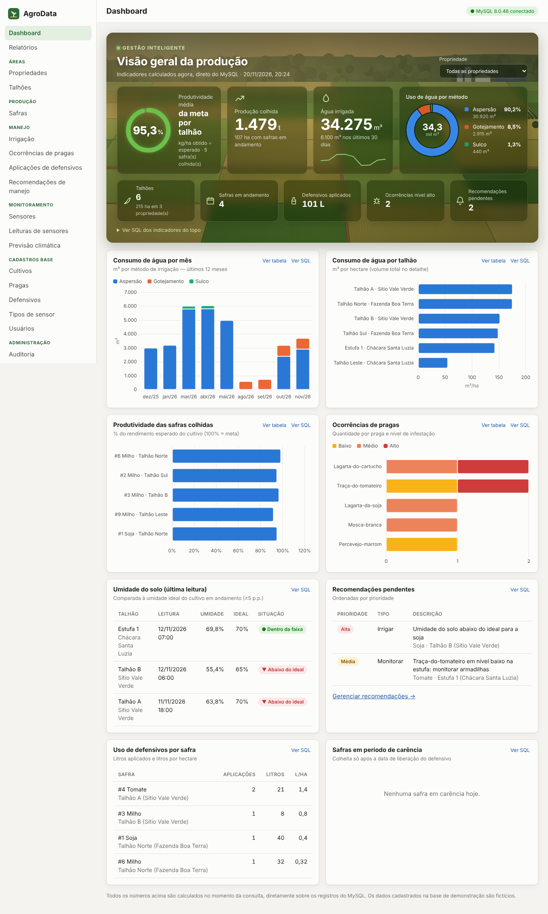

# AgroData — Banco de Dados para Agricultura Sustentável

Plataforma web para gestão agrícola por talhão: propriedades, talhões, safras, irrigação, sensores, pragas, defensivos, clima e recomendações de manejo — tudo persistido em **MySQL** e consultado por uma **API REST** em Node.js/Express.

> Projeto acadêmico da A3 de Banco de Dados — Universidade Anhembi Morumbi (Prof.ª Cássia Assis), 2026.
> Equipe: Julia Sheridan Silva · Paulo Gustavo Gomes Brunetti.

**Aplicação online:** https://agrodata-production.up.railway.app (Railway · MySQL 8.4)

**Os dados de demonstração são fictícios** e servem apenas para ilustrar o funcionamento do sistema.



---

## Funcionalidades

| Módulo | O que faz |
|---|---|
| **Dashboard** | Painel de abertura com uma fazenda ao fundo e os números em destaque: produtividade média em relação à meta (medidor), produção colhida, água irrigada com tendência mensal e gráfico de pizza do uso de água por método. Abaixo, indicadores calculados em tempo real por consultas SQL: água irrigada (total, 30 dias, por mês e método, m³/ha por talhão), produtividade das safras (kg/ha × esperado e m³ de água por tonelada), ocorrências de pragas por nível, uso de defensivos (L/ha), umidade do solo × ideal do cultivo, safras em carência e recomendações pendentes. Filtro por propriedade. Cada card mostra o **SQL usado** e uma **tabela alternativa** ao gráfico. |
| **Relatórios (stored procedures)** | Consumo de água por período e resumo de sustentabilidade da safra, calculados por procedures no MySQL. O botão **Colher** em Safras executa `sp_registrar_colheita`. |
| **Auditoria** | Histórico (antes/depois em JSON) de toda inclusão, alteração e exclusão de irrigações, aplicações de defensivos e safras, gravado por triggers. Somente leitura. |
| **Recomendações automáticas** | Triggers criam recomendações quando uma praga é registrada em nível alto ou quando a umidade do solo fica abaixo do ideal do cultivo. |
| **Cadastros completos (CRUD)** | Propriedades, talhões, safras, irrigação, ocorrências de pragas, aplicações de defensivos, recomendações, sensores, leituras, previsão climática, cultivos, pragas, defensivos, tipos de sensor e usuários. |
| **Listagens** | Busca textual, filtros (propriedade, talhão, safra, método, status, período…), ordenação por coluna, paginação e totais (ex.: volume total de água no filtro). |
| **Validação** | No servidor (campos obrigatórios, tipos, faixas, datas, enums, e-mail) e no banco (FK, UNIQUE, CHECK). Erros do MySQL são traduzidos para mensagens claras (ex.: "Registro em uso" ao tentar excluir uma propriedade com talhões). |
| **Regras de negócio** | Na API e no banco (triggers): irrigação e aplicação não podem ser anteriores ao plantio; ocorrência vinculada a uma aplicação deve ser da mesma safra; colheita prevista ≥ plantio; colheita não pode ser registrada duas vezes; data de liberação calculada pela carência do defensivo. |

## Arquitetura

```
Navegador (HTML/CSS/JS)  ──HTTP/JSON──▶  API REST (Node.js + Express)  ──mysql2──▶  MySQL 8
        ▲                                         │
        └────────────── telas e dashboard ◀───────┘
```

O navegador **nunca** acessa o banco diretamente. A API e o frontend rodam no mesmo serviço (Express serve os arquivos de `public/`), o que simplifica o deploy.

| Camada | Tecnologia |
|---|---|
| Banco de dados | MySQL 8: 17 tabelas do modelo + auditoria, PK/FK, UNIQUE, CHECK, 10 índices, 3 views, 16 triggers, 3 procedures, 1 function, perfis de acesso (DCL) |
| Backend / API | Node.js 20+, Express 5, mysql2 (pool, consultas parametrizadas), helmet |
| Frontend | HTML, CSS e JavaScript puro; Chart.js para os gráficos |
| Testes | `node:test` + supertest contra um MySQL real |
| Hospedagem | Railway (serviço Node + serviço MySQL) |

## Estrutura do repositório

```
database/
  00_create_database.sql   cria o banco (uso local)
  01_schema.sql            estrutura das 17 tabelas (extraída do dump original, sem alterações)
  02_views.sql             views de relatório (consumo por talhão, produtividade, irrigação detalhada)
  03_auditoria_indices.sql tabela de auditoria e índices de otimização
  04_triggers.sql          regras de negócio, auditoria e recomendações automáticas
  05_procedures.sql        stored procedures e function
  06_seed.sql              dados de demonstração sem duplicatas (APAGA os dados atuais)
  07_seguranca_dcl.sql     perfis, usuários, GRANT/REVOKE (execução manual)
  08_consultas.sql         consultas de análise para o relatório
  original/bd_agro_data.sql  dump original entregue pela equipe
src/
  server.js                inicialização (e criação automática do banco vazio)
  app.js                   montagem do Express e das rotas
  resources.js             definição de cada recurso: campos, validações, colunas, JOINs e filtros
  routes/dashboard.js      consultas SQL dos indicadores
  routes/relatorios.js     chamadas às stored procedures
  lib/                     conexão, CRUD genérico, validação, erros, inicialização do banco
public/                    frontend (index.html, css, js)
tests/api.test.js          38 testes de integração
docs/banco-de-dados.md     modelagem, normalização, índices, triggers, procedures, segurança e backup
docs/testes.md             evidências de testes e capturas de tela
```

### Sobre os dados

O dump original (`database/original/bd_agro_data.sql`) tinha linhas repetidas (propriedades 3–4, talhões 5–8, safras 6–10 e irrigações 9–16 duplicavam as anteriores). As **17 tabelas** foram mantidas exatamente como estavam; foram apenas acrescentados objetos (tabela de auditoria, índices, views, triggers e procedures). O arquivo `06_seed.sql` reúne os registros originais sem as duplicatas e acrescenta dados fictícios coerentes (uma terceira propriedade, novas safras, irrigações, leituras, ocorrências e recomendações) para o dashboard ter o que mostrar.

## Como rodar localmente

Pré-requisitos: Node.js 20+ e um MySQL 8 acessível.

```bash
git clone <url-do-repositorio>
cd agrodata
npm install
cp .env.example .env          # edite com usuário/senha do seu MySQL
mysql -u root -p < database/00_create_database.sql   # cria o banco "agrodata"
npm run db:init               # tabelas + views + dados de demonstração
npm start                     # http://localhost:3000
```

Se o banco já tem as tabelas e dados (por exemplo, importados do dump pelo MySQL Workbench), basta configurar o `.env` e rodar `npm start`: a cada inicialização a aplicação (re)aplica views, índices, triggers e procedures sem tocar nos dados. Com o banco **vazio**, também cria as tabelas e os dados de demonstração. Desative com `AUTO_INIT_DB=false`.

| Script | Ação |
|---|---|
| `npm start` | Sobe a aplicação |
| `npm run dev` | Sobe com recarga automática |
| `npm run db:init` | Cria tabelas (se não existirem), views, índices, triggers e procedures, e insere os dados de demonstração |
| `npm run db:seed` | Recarrega só os dados de demonstração (**apaga os dados atuais**) |
| `npm test` | Roda os testes contra o banco `TEST_DB_NAME` (recriado a cada execução) |

## Deploy no Railway

1. Em [railway.com](https://railway.com), crie um projeto **Deploy from GitHub repo** e selecione este repositório.
2. No mesmo projeto, clique em **+ New → Database → MySQL**.
3. No serviço da aplicação, aba **Variables**, adicione:
   - `DATABASE_URL` = `${{MySQL.MYSQL_URL}}` (referência ao banco, pela rede privada do Railway)
4. Aba **Settings → Networking → Generate Domain** para obter a URL pública.
5. No primeiro start a aplicação detecta o banco vazio e cria as tabelas, views, triggers, procedures e dados de demonstração. Confira em `https://<sua-url>/api/health`.

O `railway.json` já define o comando de start e o health check (`/api/health`).

## API REST

Base: `/api`. Todas as respostas são JSON.

| Método | Rota | Descrição |
|---|---|---|
| GET | `/health` | Status da conexão com o MySQL |
| GET | `/meta` | Metadados dos recursos (campos, colunas, filtros) usados pelo frontend |
| GET | `/dashboard?id_propriedade=` | Indicadores + SQL de cada consulta |
| GET | `/relatorios/consumo-agua?de=&ate=&id_propriedade=` | `CALL sp_consumo_agua_periodo` |
| GET | `/relatorios/safras/{id}` | `CALL sp_resumo_safra` |
| POST | `/relatorios/safras/{id}/colheita` | `CALL sp_registrar_colheita` (corpo: `quantidade_colhida_kg`) |
| GET | `/{recurso}` | Lista com `q`, filtros, `sort`, `dir`, `page`, `limit` |
| GET | `/{recurso}/options` | Pares `{id, label}` para campos de seleção |
| GET | `/{recurso}/{id}` | Um registro |
| POST | `/{recurso}` | Cria (201) |
| PUT | `/{recurso}/{id}` | Atualiza todos os campos |
| PATCH | `/{recurso}/{id}` | Atualiza campos enviados |
| DELETE | `/{recurso}/{id}` | Exclui (204); 409 se houver registros vinculados |

Recursos: `propriedades`, `talhoes`, `safras`, `irrigacoes`, `ocorrencias`, `aplicacoes`, `recomendacoes`, `sensores`, `leituras`, `previsoes`, `cultivos`, `pragas`, `defensivos`, `tipos-sensor`, `usuarios` e `auditoria` (somente leitura).

Exemplo:

```bash
curl -X POST https://<sua-url>/api/irrigacoes \
  -H "Content-Type: application/json" \
  -d '{"id_safra":5,"data_hora":"2026-11-19T07:30","volume_m3":250,"duracao_min":90,"metodo":"aspersao"}'

curl "https://<sua-url>/api/irrigacoes?id_propriedade=2&metodo=gotejamento&de=2026-08-01"
```

Códigos de erro: `400` dados inválidos (com `details` por campo, ou a mensagem de um trigger/procedure), `404` não encontrado, `409` conflito (registro em uso ou valor único duplicado), `503` banco indisponível.

## Testes

`npm test` executa 38 testes de integração contra um MySQL real: estrutura do banco, CRUD ponta a ponta (formulário → API → MySQL → leitura), validações, chaves estrangeiras, triggers (regras, auditoria e recomendações automáticas), stored procedures, filtros e a conferência dos indicadores do dashboard com consultas diretas ao banco. Resultado e evidências em [`docs/testes.md`](docs/testes.md).

## Segurança

- Credenciais apenas em variáveis de ambiente (`.env` fora do Git; ver `.env.example`).
- Todas as consultas usam parâmetros (`?`) — sem concatenação de valores do usuário no SQL.
- Cabeçalhos de segurança e Content-Security-Policy via `helmet`; corpo JSON limitado a 100 kB.
- Perfis de acesso no banco (roles `agro_administrador`, `agro_agronomo`, `agro_operador`, `agro_auditor`) e usuário de aplicação com menor privilégio em `database/07_seguranca_dcl.sql`; plano de backup e recuperação em [`docs/banco-de-dados.md`](docs/banco-de-dados.md).
- A tabela `usuario` do modelo não possui senha, portanto **não há login** nesta versão; os perfis (administrador, agrônomo, operador, auditor) são cadastrados e associados às aplicações. Autenticação e controle de acesso por perfil ficam como trabalho futuro. Por isso, a instância pública deve conter apenas dados de demonstração.

## Trabalhos futuros

Autenticação na aplicação com os perfis de acesso, ingestão automática de leituras de sensores (IoT), integração com API de previsão do tempo e novas regras de recomendação automática (previsão de chuva, carência).
