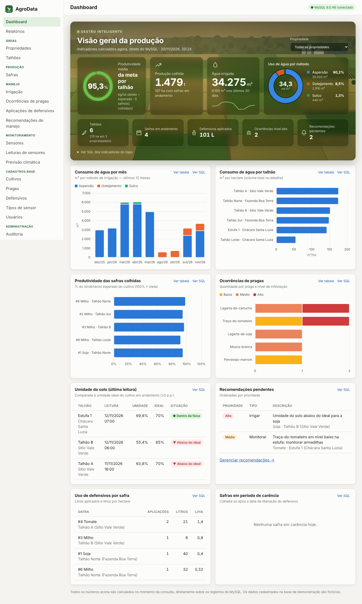
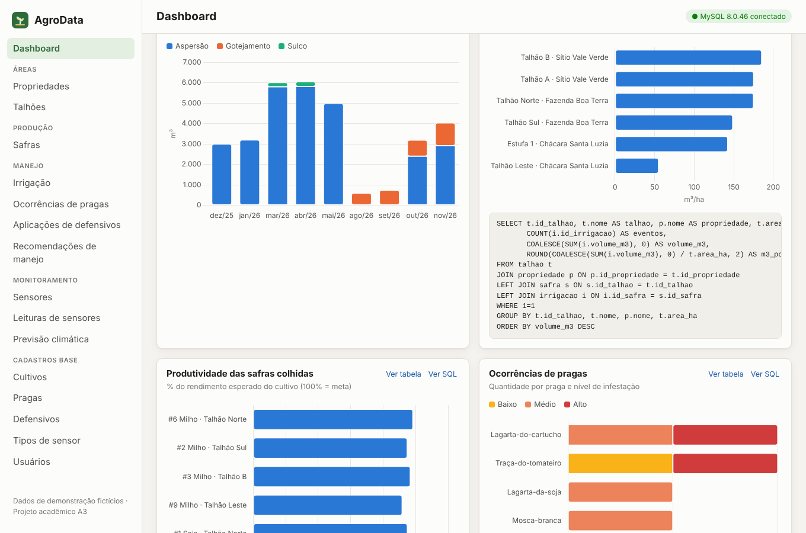
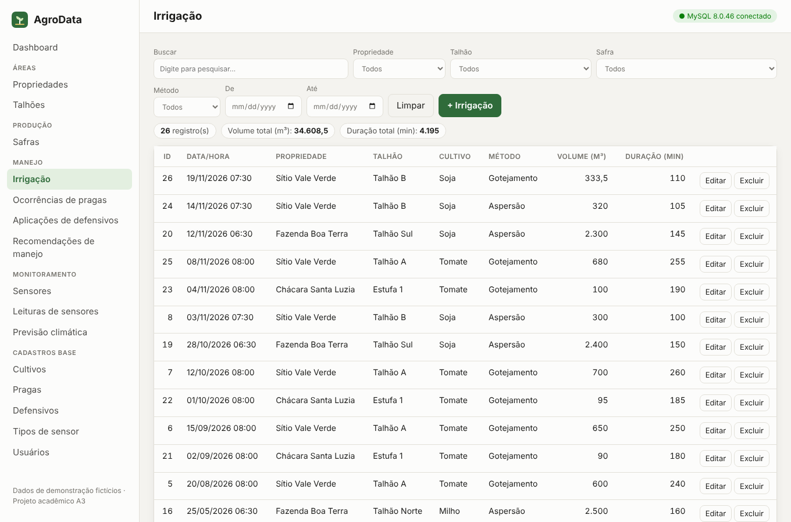
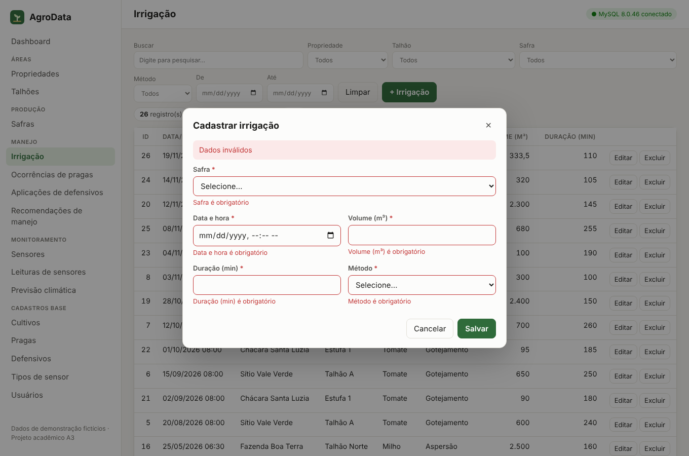
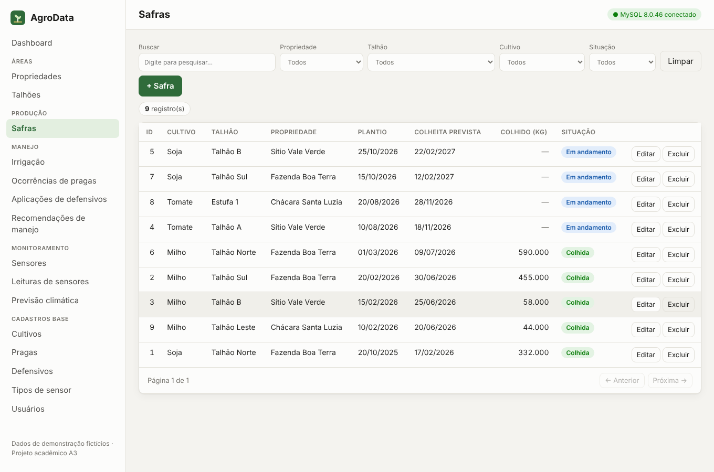

# Evidências de testes — AgroData

Ambiente: Node.js 22, MySQL 8.0.46, executado em 20/11/2026.
Comando: `npm test` (banco `agrodata_test`, recriado a partir de `database/01_schema.sql`, `02_views.sql` e `03_seed.sql`).

## Resultado: 27 de 27 testes aprovados

| Grupo | Caso de teste | Resultado |
|---|---|---|
| infraestrutura | health check confirma conexão com o MySQL | ✅ aprovado |
| infraestrutura | banco possui as 17 tabelas do modelo | ✅ aprovado |
| infraestrutura | seed não contém duplicatas de propriedade/talhão | ✅ aprovado |
| infraestrutura | metadados expõem os recursos para o frontend | ✅ aprovado |
| infraestrutura | rota inexistente retorna 404 JSON | ✅ aprovado |
| propriedades e talhões (CRUD ponta a ponta) | cria propriedade e persiste no MySQL | ✅ aprovado |
| propriedades e talhões (CRUD ponta a ponta) | rejeita propriedade sem campos obrigatórios e área inválida | ✅ aprovado |
| propriedades e talhões (CRUD ponta a ponta) | cria talhão vinculado à propriedade | ✅ aprovado |
| propriedades e talhões (CRUD ponta a ponta) | rejeita talhão com propriedade inexistente (FK) | ✅ aprovado |
| propriedades e talhões (CRUD ponta a ponta) | lista com busca e filtro por propriedade | ✅ aprovado |
| propriedades e talhões (CRUD ponta a ponta) | edita propriedade (PUT) e atualização parcial (PATCH) | ✅ aprovado |
| propriedades e talhões (CRUD ponta a ponta) | impede excluir propriedade que possui talhões (409) | ✅ aprovado |
| propriedades e talhões (CRUD ponta a ponta) | exclui talhão e depois a propriedade | ✅ aprovado |
| propriedades e talhões (CRUD ponta a ponta) | ID inválido retorna 400 | ✅ aprovado |
| irrigação, safras e regras de negócio | registra irrigação e soma no resumo da listagem | ✅ aprovado |
| irrigação, safras e regras de negócio | valida método, volume e data/hora da irrigação | ✅ aprovado |
| irrigação, safras e regras de negócio | filtra irrigações por período e método | ✅ aprovado |
| irrigação, safras e regras de negócio | filtro inválido retorna 400 | ✅ aprovado |
| irrigação, safras e regras de negócio | safra não aceita colheita antes do plantio | ✅ aprovado |
| irrigação, safras e regras de negócio | aplicação de defensivo exige ocorrência da mesma safra | ✅ aprovado |
| irrigação, safras e regras de negócio | e-mail de usuário único (409) e formato validado (400) | ✅ aprovado |
| irrigação, safras e regras de negócio | atualiza status de recomendação | ✅ aprovado |
| irrigação, safras e regras de negócio | options devolve rótulos legíveis para selects | ✅ aprovado |
| dashboard (indicadores calculados no MySQL) | KPIs batem com consultas diretas ao banco | ✅ aprovado |
| dashboard (indicadores calculados no MySQL) | consumo por talhão soma o total geral | ✅ aprovado |
| dashboard (indicadores calculados no MySQL) | filtro por propriedade restringe os indicadores | ✅ aprovado |
| dashboard (indicadores calculados no MySQL) | produtividade calcula kg/ha da safra 1 (332 t em 100 ha) | ✅ aprovado |

## Saída do terminal (resumo)

```
# tests 27
# suites 4
# pass 27
# fail 0
```

## Teste manual ponta a ponta (navegador)

1. Abrir **Irrigação → + Irrigação** e clicar em **Salvar** sem preencher: o formulário exibe "Dados inválidos" e a mensagem de cada campo obrigatório (validação da API).
2. Preencher safra, data/hora, volume, duração e método e salvar: o registro aparece na lista e o total de água do filtro é atualizado.
3. Recarregar a página (F5): o registro continua listado — veio do MySQL.
4. Abrir o **Dashboard**: o KPI "Água total irrigada" e o gráfico mensal incluem o novo volume; "Ver SQL" mostra a consulta executada.
5. Tentar excluir uma propriedade que tem talhões: a API responde 409 e a tela mostra "Registro em uso".

| Tela | Captura |
|---|---|
| Dashboard |  |
| SQL exibido no dashboard |  |
| Listagem de irrigação com filtros |  |
| Validação do formulário |  |
| Safras |  |
